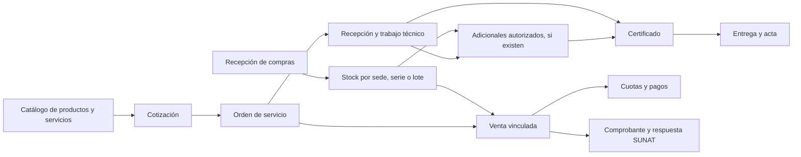

# BRUCE FIRE frente a sistemas consolidados: productos y procesos

Fecha de consulta: 10/10/2026. Resultado: investigación y propuesta; las mejoras siguientes todavía no están implementadas.

## 1. Conclusión y alcance

La prioridad es hacer comprensible la operación que ya existe: distinguir catálogo, stock y equipo del cliente; mostrar qué falta, quién continúa y qué documento se relaciona con cada trabajo. Ampliar el número de módulos antes de resolver esas preguntas aumentaría la dificultad de uso.

La auditoría anterior recorrió los cinco roles, 40 pantallas y 68 acciones; identificó 274 controles. No verificó todos los controles en todos los estados. Las 957 pruebas automatizadas que pasaron son evidencia complementaria, no equivalen a una certificación completa de la interfaz. Entrega con acta, consumo/resolución de deficiencias autorizadas, GRE y dispositivos siguen pendientes de validación navegada.

Se investigaron **productos públicos de Shopify, Odoo 19, Zoho Inventory y Microsoft Dynamics 365 Field Service**. Sus manuales explican capacidades documentadas; no revelan cómo opera internamente cada empresa grande que los utiliza. No se contrataron cuentas ni se probaron sus consolas. Las recomendaciones son inferencias adaptadas a BRUCE FIRE, diferenciadas de las funciones que las fuentes describen.

La comparación local utiliza la revisión navegada del 09–10/10 y lecturas puntuales del código actual. Los anexos antiguos sirven como antecedentes: por ejemplo, la supuesta ausencia de costo de compra y traslados en tránsito ya no representa la implementación actual. No hay grafo de código disponible; se contrastaron fuentes directamente.

## 2. Qué aporta cada referencia

| Referencia                 | Práctica documentada                                                                                                                          | Qué conviene adaptar                                                                                                                                                                                                                                                                                                                          |
| -------------------------- | --------------------------------------------------------------------------------------------------------------------------------------------- | --------------------------------------------------------------------------------------------------------------------------------------------------------------------------------------------------------------------------------------------------------------------------------------------------------------------------------------------- |
| Shopify                    | Alta que empieza por el título; duplicación de productos similares; distinción entre SKU/código de barras y variantes.                        | Alta sencilla y reutilización de información del catálogo. No adoptar canales de comercio electrónico para resolver el taller. [Productos](https://help.shopify.com/en/manual/products/add-update-products).                                                                                                                                  |
| Odoo 19                    | Bienes y servicios; inventario por cantidad, lote o serie; unidad de compra y conversiones hacia la unidad de inventario.                     | Decisiones de inventario claras y equivalencias visibles. [Tipo de producto](https://www.odoo.com/documentation/19.0/applications/inventory_and_mrp/inventory/product_management/configure/type.html), [unidades](https://www.odoo.com/documentation/19.0/es/applications/inventory_and_mrp/inventory/product_management/configure/uom.html). |
| Zoho Inventory             | Bienes/servicios, trazabilidad excluyente por serie o lote, documentos comerciales enlazados y estados independientes de facturación y envío. | Separar datos de catálogo de transacciones y mostrar el avance por dimensión. [Artículos](https://www.zoho.com/us/inventory/help/items/items-overview.html), [pedidos](https://www.zoho.com/in/inventory/help/sales-orders/sales-order-managing.html).                                                                                        |
| Dynamics 365 Field Service | Órdenes de trabajo, activos del cliente con historia, inspecciones y estados operativos relacionados.                                         | Ficha del extintor y continuidad entre vendedor, taller y campo. [Historia del equipo](https://learn.microsoft.com/en-us/dynamics365/field-service/service-history), [ciclo de la orden](https://learn.microsoft.com/en-us/dynamics365/field-service/work-order-status-booking-status).                                                       |

Limitación de fuentes: varias páginas de Odoo devolvieron timeout al abrirse; sus prácticas de tipo/unidad se contrastaron con el contenido indexado de la documentación oficial. No se usaron módulos comerciales de terceros como prueba de funciones nativas. Las páginas regionales de Zoho pueden redirigir; los ejemplos fiscales de otras regiones no se trasladan a Perú.

## 3. Registrar productos: propuesta concreta

**BRUCE FIRE ya separa tres conceptos en el código:** `Product` define el artículo; `InventoryUnit` representa una unidad serializada en el almacén; `Equipment` representa un equipo del cliente. La venta de una unidad nueva enlaza esos datos. Además, `Service` representa la actividad que se cobra. Esta separación es adecuada y debe explicarse en la experiencia de uso.

Ejemplo: “Extintor PQS de 6 kg” es el artículo del catálogo; tres extintores nuevos tienen tres identificaciones de almacén; el extintor que José trae para recargar es un equipo de José; la recarga es un servicio. Dar de alta el equipo del cliente no debe aumentar stock comercial. Dynamics documenta el enlace del activo con su cliente, ubicación e historial de trabajos. [Activos de servicio](https://learn.microsoft.com/en-us/dynamics365/guidance/business-processes/service-to-cash-manage-service-assets).

El formulario recientemente corregido ya tiene nombre/precio primero, inventario excluyente, datos adicionales plegables, pie fijo y recuperación de errores. El siguiente paso debe mejorar las decisiones que aún requieren conocimiento del sistema:

| Momento                 | Pregunta que entiende el usuario                                                       | Resultado propuesto                                                                                              |
| ----------------------- | -------------------------------------------------------------------------------------- | ---------------------------------------------------------------------------------------------------------------- |
| Elegir el recorrido     | ¿Registrar algo que vendemos, un servicio o un equipo de un cliente?                   | Accesos claros hacia los formularios existentes, sujetos a permisos; no mezclar las entidades.                   |
| Identificar el artículo | ¿Qué producto es?                                                                      | Nombre, categoría, código interno y precio. Ejemplo de código y explicación de que no es una serie física.       |
| Controlar existencias   | ¿Contamos unidades iguales, identificamos cada una o controlamos vencimiento por lote? | Elección cantidad/serie/lote con casos reales y consecuencia visible.                                            |
| Comprar y transportar   | ¿Lo compro por caja? ¿Cuántas unidades trae?                                           | Datos opcionales y resumen: “1 caja = 12 unidades”; peso separado de capacidad del extintor.                     |
| Guardar                 | ¿Qué acabamos de crear y cómo ingreso existencias?                                     | Confirmación: “Producto registrado. Stock inicial: 0. Almacén registra la recepción”. Continuación según el rol. |

Propuesta de perfiles sugeridos: **extintor nuevo**, **repuesto/accesorio**, **EPP/consumible** y **otro producto**. Son ayudas de formulario editables, no nuevas clases fiscales ni entidades. Deben reutilizar categorías y campos existentes; ningún perfil debe inventar agente, capacidad, marca, afectación tributaria o series. El control por serie requiere confirmación antes de guardar.

Ejemplos de prueba de usabilidad: registrar un soporte por cantidad; un extintor por serie; un consumible por lote; una compra de dos cajas de doce. El usuario debe poder explicar qué se vende, cómo se cuenta y dónde se registrará la entrada sin consultar el código.

**Crear desde uno similar** es una candidata posterior: copiar atributos comerciales revisables, pedir código único y no copiar series, stock, movimientos ni equipos del cliente. Shopify documenta la duplicación del catálogo; nuestra implementación requeriría definir alcance y pruebas antes de construirla. [Duplicación](https://help.shopify.com/en/manual/products/add-update-products#duplicate-a-product).

## 4. Comparación de los procesos relacionados

| Proceso / roles                                 | Referencia externa                                                                                                                                                                         | BRUCE FIRE actual y cobertura                                                                                                                           | Mejora o decisión                                                                                                                           |
| ----------------------------------------------- | ------------------------------------------------------------------------------------------------------------------------------------------------------------------------------------------ | ------------------------------------------------------------------------------------------------------------------------------------------------------- | ------------------------------------------------------------------------------------------------------------------------------------------- |
| Catálogo / Gerente                              | Shopify facilita alta y duplicación; Odoo/Zoho distinguen trazabilidad.                                                                                                                    | Catálogo compartido, productos/servicios y modalidades; crear/editar y estados probados.                                                                | Perfiles comprensibles, distinguir códigos y continuidad hacia recepción.                                                                   |
| Recepción / Almacén                             | Zoho registra recepción y captura series/lotes al recibir. [Recepciones](https://www.zoho.com/in/inventory/help/purchase-orders/purchase-receive.html).                                    | Cantidad, conformes, observados, costos, cajas y unidades; caso 3/2/1 probado.                                                                          | Resumen previo del efecto en stock, conversión de cajas y observados. Evitar una nueva pantalla que replique esta recepción.                |
| Stock y traslados / Almacén                     | Zoho diferencia iniciar tránsito y confirmar llegada. [Traslados](https://www.zoho.com/in/inventory/help/warehouses/transfer-orders.html).                                                 | Código actual ya separa preparación, despacho con guía y recepción; destino no recibe disponible hasta confirmar. GRE completa pendiente de navegación. | Hacer visibles bloqueos, responsable de destino y documentos enlazados; probar el flujo existente antes de añadir lógica.                   |
| Cotización y venta / Vendedor                   | Zoho genera factura desde pedido, reutiliza sus datos y distingue envío/facturación. [Pedidos](https://www.zoho.com/in/inventory/help/sales-orders/sales-order-managing.html).             | COT→OT→venta comprobado en un caso; ficha de orden tiene Ver venta/Cobrar y eventos.                                                                    | Franja común de documentos relacionados y resumen del importe pendiente; distinguir registrar venta, cobrar y emitir comprobante.           |
| Taller / Planta y Vendedor                      | Dynamics conecta ejecución, revisión y estados de orden. [Ciclo](https://learn.microsoft.com/en-us/dynamics365/field-service/work-order-status-booking-status).                            | Recepción/checklist/ejecución/cierre hasta certificado probados; modelo mantiene 13 estados y etiquetas simplificadas.                                  | Mostrar la siguiente acción, requisito faltante y rol responsable; conservar la fuente única del estado.                                    |
| Deficiencias / Planta, Vendedor y Almacén       | Dynamics diferencia material estimado/reservado y consumido. [Inventario del servicio](https://learn.microsoft.com/en-us/dynamics365/field-service/inventory-purchasing-returns-overview). | Autorización y consumo existen; recorrido con deficiencia autorizada pendiente.                                                                         | Mostrar detectado→cotizado→autorizado→consumido→resuelto con costo/stock en contexto. Validar primero duplicidad, rechazo y falta de stock. |
| Campo / Técnico de campo                        | Dynamics integra inspecciones con tareas y admite validación/adjuntos. [Inspecciones](https://learn.microsoft.com/en-us/dynamics365/field-service/inspections).                            | Recojo, instalación/inspección y entrega con acta previstos en pantallas/modelos; caso completo pendiente.                                              | Tareas cortas para celular, equipo y ubicación visibles, progreso de equipos y confirmación final de entrega.                               |
| Equipo del cliente / Vendedor y técnicos        | Dynamics relaciona activo, trabajos y mantenimiento. [Historia](https://learn.microsoft.com/en-us/dynamics365/field-service/service-history).                                              | Equipment ya enlaza cliente, producto, órdenes, checklists y próximas fechas; cliente tiene equipos/historial/certificados.                             | Mejorar conexiones existentes por BF-EQ; evitar crear otro maestro o prometer una historia inexistente.                                     |
| Cobro y caja / Vendedor y Gerente               | Zoho separa deuda de pagos y permite aplicaciones parciales. [Pagos](https://www.zoho.com/us/inventory/help/payments-received/payments-received.html).                                     | Pagos 20+25, límite por saldo, historial y caja probados en copia; textos corregidos.                                                                   | Vistas claras “Por cobrar / Pagos registrados”; mantener arqueo ciego. Un cobro para varias ventas sería alcance nuevo.                     |
| Certificado y cierre / Planta, Vendedor y Campo | La referencia de Dynamics separa trabajo completado y revisión posterior; no aporta reglas para nuestros certificados.                                                                     | Certificado con snapshot y QR, orden/venta relacionadas; falta validar entrega física/acta.                                                             | Mostrar taller terminado, certificado emitido, entregado y cobrado por separado. Conservar inmutabilidad del certificado y reglas propias.  |
| Seguimiento / Gerente                           | Zoho ofrece informes de saldos/clientes. [Cuentas por cobrar](https://www.zoho.com/in/inventory/help/reports/receivables-reports.html).                                                    | Dashboard ya calcula deuda vencida, stock crítico, atención próxima y comprobantes por vencer.                                                          | Convertir indicadores en enlaces con filtro equivalente y una lista de trabajo; no rehacer cálculos ni añadir tarjetas vacías.              |

## 5. Cómo debería entenderse una operación

El diagrama muestra relaciones y recorridos posibles, no impone una secuencia fiscal o comercial nueva. Venta/cobro pueden ocurrir en distintos momentos según las reglas actuales. Un certificado listo no demuestra que el cliente recibió el equipo; SUNAT aceptado no demuestra que pagó; haber cobrado no demuestra que terminó el taller.

Propuesta para una ficha de operación: **Trabajo: en proceso · Cobro: S/25 pendiente · Certificado: pendiente · Entrega: pendiente · Comprobante: aceptado**. Debajo: “Siguiente acción: vendedor autoriza el cambio de válvula”. Es una recomendación de presentación derivada de la comparación; no debe introducir un nuevo estado global ni duplicar los ya guardados.

## 6. Orden recomendado de mejoras y cómo aceptar cada una

| Orden | Trabajo concreto                                                   | Tipo / esfuerzo relativo                                 | Criterio de aceptación                                                                                                                   |
| ----- | ------------------------------------------------------------------ | -------------------------------------------------------- | ---------------------------------------------------------------------------------------------------------------------------------------- |
| 0     | Completar casos pendientes de la auditoría navegada.               | Validación / medio; GRE depende de configuración válida. | Evidencia por rol, estado y acción; recorrido de deficiencia y entrega con acta, incluyendo error y cancelación.                         |
| 1     | Perfiles y confirmación comprensible de producto.                  | UX con campos existentes / pequeño–medio.                | Usuario registra cantidad/serie/lote sin confundir artículo con unidad; alta no aumenta stock; errores y teclado conservados.            |
| 2     | Documentos relacionados y siguiente acción en la orden.            | UX sobre relaciones existentes / medio.                  | Puede abrir cotización, venta, certificado y entrega autorizados; bloqueos dicen motivo y responsable; no se filtran datos de otra sede. |
| 3     | Resumen de recepción y equivalencias.                              | UX / pequeño–medio.                                      | “2 cajas × 12 = 24 unidades”; solo conformes ingresan; resumen coincide con movimiento guardado y costo.                                 |
| 4     | Continuidad de deficiencia y tareas móviles de campo.              | UX + validación de flujo existente / medio.              | Misma deficiencia/equipo en cada paso; sin consumo repetido; acta identifica los equipos realmente entregados.                           |
| 5     | Saldos, historial y pendientes del gerente con enlaces.            | UX / pequeño–medio.                                      | S/45 original, S/20 pagado, S/25 saldo; filtros del indicador coinciden con tabla; caja conserva conteo ciego.                           |
| 6     | Copiar producto similar, sugerir código, carga masiva o variantes. | Candidatas de alcance / estimación posterior.            | Primero documentar necesidad, REQ/historia/matriz y reglas de unicidad; no copiar stock ni datos de clientes.                            |

Los tamaños son comparaciones cualitativas, no compromisos de días. Medición propuesta antes/después: tiempo de alta, campos que requieren ayuda, errores de identificación, veces que se cambia de módulo para resolver una tarea y órdenes detenidas sin responsable claro. Todavía no se han medido esas métricas.

## 7. Límites que deben conservarse

BRUCE FIRE es un sistema de gestión de ventas y servicio, con cinco roles y catálogo compartido; contabilidad y planillas están fuera de alcance. Adaptar patrones de ERP no significa ampliar automáticamente su alcance. Las nuevas funciones requieren la trazabilidad académica indicada en PROYECTO.md.

Conservar identificación BF-EQ, historial, snapshots del certificado, permisos por sede, eventos de custodia, costo promedio existente y movimientos de Kardex. Usar las relaciones y componentes actuales. Las recomendaciones externas no cambian IGV, oportunidad fiscal de emisión, cancelaciones ni requisitos de GRE/SUNAT; esos temas requieren validación específica del módulo correspondiente.

Automatización de compras, pagos de varias ventas en una operación, modo sin conexión, portal de clientes y mensajería externa quedan como posibles ampliaciones a evaluar por necesidad real. No forman parte de la primera mejora recomendada.

## 8. Evidencia local contrastada

Lecturas de la versión de trabajo del 10/10/2026, que conserva modificaciones de sesiones anteriores:

- `app/Models/Product.php`: modalidades de stock, mínimo y costo promedio de compra.
- `app/Models/InventoryUnit.php`, `app/Models/Equipment.php` y `app/Actions/Sales/ProcessSaleItem.php`: artículo, unidad física, equipo del cliente y tratamiento de venta/servicio.
- `app/Http/Requests/Gerente/StoreProductRequest.php`, `app/Http/Controllers/Gerente/ProductController.php`: datos exigidos y restricción de cambios de serie con historial.
- `app/Models/ServiceOrder.php`, `resources/js/pages/vendedor/ordenes-servicio/show.tsx`: estados, eventos y enlace de venta existentes.
- `app/Actions/Almacen/TransferInventory.php`: despacho, tránsito y confirmación en destino.
- `resources/js/pages/almacen/recepciones/create.tsx`: cantidades conformes, observadas, cajas, costo y series.
- `resources/js/pages/vendedor/clientes/show.tsx`, `app/Http/Controllers/Gerente/DashboardController.php`: historial/equipos y seguimiento existentes.
- `app/Models/CertificateUnit.php` y `docs/ai/PROYECTO.md`: datos del certificado y decisiones de conservación.
- `docs/ai/REVISION_NAVEGADA_2026_10_10.md`: evidencia navegada y límites, usados sin ampliar sus afirmaciones.

## 9. Resultado de esta fase

Investigación terminada para los principales procesos de los cinco roles, con referencias oficiales y propuestas ordenadas. No es una evaluación exhaustiva de todas las configuraciones de los sistemas externos. Siguiente trabajo recomendado: completar las validaciones pendientes y llevar los perfiles de productos y la ficha conectada de la orden a una propuesta visual comprobable, utilizando los módulos actuales.
